# War Room technical reference

**Technical reference pilot:** system boundaries (T1), source contracts (T2), model/state/numerical identity (T3), transport/query contracts (T5/T7), persistence/lifecycle (T8) and application/frontend integration (T9). Earlier chapter-specific transfer notes remain scoped to those chapters. [DATA](DATA.md), [RESEARCH](RESEARCH.md), [PLAYER_OUTCOME_MODEL](PLAYER_OUTCOME_MODEL.md), [MONTE_CARLO](MONTE_CARLO.md), [APPLICATION_SERVICE](APPLICATION_SERVICE.md), [UNIFIED_ACTION_SEARCH](UNIFIED_ACTION_SEARCH.md), [OPERATIONS](OPERATIONS.md) and [INTERFACE](INTERFACE.md) retain their binding contracts; M0 contract 3 retains its T2 evidence homes. Analytical meaning is in [METHODOLOGY](METHODOLOGY.md), assurance in [VALIDATION](VALIDATION.md), operating procedures in [USER_GUIDE](USER_GUIDE.md)/OPERATIONS and developer checks in [CONTRIBUTING](../CONTRIBUTING.md). [Authority and precedence](../AGENTS.md#authority-and-precedence) and exact [BACKLOG](BACKLOG.md) obligations remain binding. No authority is retired or release declared.

- [T1: System architecture and integration map](#system-architecture-and-integration-map)
- [T2: Canonical, source and evidence data contracts](#canonical-source-and-evidence-data-contracts)
- [T3: Model, state and numerical identity contracts](#model-state-and-numerical-identity-contracts)
- [T5: HTTP API, DTOs and evolution](#http-api-dtos-and-evolution)
- [T7: Search interfaces, indexing and query/export contracts](#search-interfaces-indexing-and-queryexport-contracts)
- [T8: Persistence, run lifecycle and recovery](#persistence-run-lifecycle-and-recovery)
- [T9: Application and frontend security/integration contracts](#application-and-frontend-securityintegration-contracts)

## System architecture and integration map

War Room is a local application around one shared analytical engine. The frontend presents backend results; HTTP adapts typed requests and orchestrates work; pure domain components own rules, scoring, decisions and sampling. Network retrieval and persistence surround that engine rather than defining its mathematics. The [architecture overview](architecture/overview.md) retains the broader component map; [M1](METHODOLOGY.md#analytical-framework-and-objective) explains the experiment rather than the source layout.

```mermaid
flowchart LR
    Browser[React presentation] -->|relative requests / observation| HTTP[Local HTTP boundary]
    HTTP -->|synchronous analysis| Service[Application service]
    HTTP -->|submit / poll / cancel| Jobs[Bounded job coordinator]
    Jobs -->|accepted request| Service
    HTTP -->|refresh request| Refresh[Refresh coordinator]
    Refresh -->|read only| Adapter[ESPN retrieval / translation]
    Adapter -->|validated source bundle| Publish[Atomic snapshot publication]
    Publish --> Snapshots[Immutable snapshot store]
    Snapshots -->|verified selected input| Service
    Service -->|domain configuration| Engine[Shared deterministic season engine]
    Service -->|sampling / paired paths| MC[Monte Carlo / scenario / search coordinators]
    MC -->|same season mechanics| Engine
    Jobs -->|copied progress / typed results| History[Bounded application history]
    HTTP -->|retained queries| History
```



Arrows identify request/data flow, not permission escalation: a valid HTTP schema, source record, hash or stored result cannot grant missing league/live capability. Dependency direction is presentation → application adapters/coordinators → analytical/domain components and canonical data. Engines do not import the UI, serve HTTP, retrieve ESPN or write application history. Domain validation/completeness remains authoritative; frontend validation is useful feedback, not another legality/probability engine. Source snapshots and each path's immutable evolving state are different objects.

| Reader task | Source navigation / boundary |
|---|---|
| Retrieve and validate source evidence | [espn_adapter.py](../src/fantasy_football/espn_adapter.py), [canonical](../src/fantasy_football/canonical/model.py), [snapshot_store.py](../src/fantasy_football/snapshot_store.py); [T2](#canonical-source-and-evidence-data-contracts) owns the interface map, DATA owns field meaning/publication |
| Follow one season or a repeated/paired experiment | [season_simulator.py](../src/fantasy_football/season_simulator.py), [monte_carlo.py](../src/fantasy_football/monte_carlo.py), [scenario_evaluator.py](../src/fantasy_football/scenario_evaluator.py), [search_orchestration.py](../src/fantasy_football/search_orchestration.py); M3–M9/current domain owners define mathematics and action semantics |
| Trace an application request | [http.py](../src/fantasy_football/app/http.py) → [service.py](../src/fantasy_football/app/service.py); [T5](#http-api-dtos-and-evolution) owns the complete wire map; background/refresh are separate execution coordinators |
| Locate execution versus retained data | [background.py](../src/fantasy_football/app/background.py), [refresh.py](../src/fantasy_football/app/refresh.py), [numerical recovery](../src/fantasy_football/monte_carlo_execution.py); T8 distinguishes owners/lifetimes; [T7](#search-interfaces-indexing-and-queryexport-contracts) owns temporary indexing/query/export interfaces |
| Follow presentation and draft bookkeeping | [App.tsx](../frontend/src/App.tsx), [API client](../frontend/src/lib/api.ts), [TradeLab.tsx](../frontend/src/TradeLab.tsx); T9 and INTERFACE own isolation/presentation, not alternate analytical rules |
| Understand local process ownership | [server.py](../src/fantasy_football/app/server.py), [launcher identity helpers](../scripts/local-runtime.ps1); T8/T9 explain the boundary, OPERATIONS owns startup/shutdown/recovery commands |

The deterministic coordinator reuses weekly transactions, lineup optimization, weekly scoring and postseason resolution. Monte Carlo generates path-indexed player/week outcomes and repeatedly invokes that same coordinator; hypothetical scenarios/search reuse matched paths and the existing aggregation. Opt-in partial evidence feeds that coordinator after its separate permission checks. It is not another season simulator, and engine support does not imply public partial-week requests. See [M3](METHODOLOGY.md#season-simulation-and-lineup-optimization), [M4](METHODOLOGY.md#current-week-and-partial-week-treatment) and the [capability map](PARTIAL_WEEK.md#current-capability-map).

At refresh, sequential read-only source retrieval/translation occurs outside publication's SQLite write transaction; publication appends verified immutable evidence. At analysis, the service loads the explicitly selected snapshot, checks identity/capabilities and translates DTO configuration into domain inputs. Synchronous results return directly; accepted background work has a durable run ID and explicit lifecycle. Retained queries read copied results without Monte Carlo or a new ESPN request. The browser is an untrusted input/presentation boundary, raw source semantics require validation, and private stores/pickle scratch remain trusted-process material rather than safe public interchange.

## Canonical, source and evidence data contracts

### Adapter and canonical interfaces

[espn_adapter.py](../src/fantasy_football/espn_adapter.py) separates sequential `retrieve_bundle()` from pure `translate_bundle()`; `fetch_and_translate()` composes them. `CapturedResponse`, `PlayerPage`, `EspnSourceBundle` and the resulting `SourceReference` preserve sanitized request/source identity, context, retrieval UTC and deterministic parsed-payload digest. These are not HTTP wire-byte archives or secret-bearing authentication records. Exact endpoint/field transformations, pagination, current-versus-future ownership and reconciliation remain in [D1](DATA.md#data-lifecycle-and-source-provenance) and [D3](DATA.md#inputs-transformations-and-league-rule-authority).

Canonical SourceReference binds source_id, endpoint, view, parameters, retrieved_at_utc and payload_sha256 to the captured parsed response. Those fields preserve source context/integrity, not independent authentication of ESPN semantics; position IDs and lineup-slot IDs remain different namespaces and a valid schema cannot grant consumer capability.

| Interface / representation | Current contract and authoritative detail |
|---|---|
| `LeagueSnapshot`, frozen records/tuples in [model.py](../src/fantasy_football/canonical/model.py) | Canonical schema 4; supported reads 2/3/4, new publication 4. Flat IDs/joins; roster ownership exists only in RosterEntry. See [canonical invariants](DATA.md#canonical-validation-and-serialization). |
| `validate_snapshot()` in [validation.py](../src/fantasy_football/canonical/validation.py) | Pure, deterministic, nonmutating structural/context validation; coherent unsupported capabilities remain consumer-gated. No source hash creates permission. |
| `snapshot_to_json()` / `snapshot_from_json()` in [serialization.py](../src/fantasy_football/canonical/serialization.py) | Deterministic ordered, indented, newline-terminated UTF-8 JSON; UTC Z, explicit null/zero/signed numbers, no nonfinite values. Decode revalidates. Older reads/defaults do not recreate historical bytes or live authority. |
| `SnapshotStore` in [snapshot_store.py](../src/fantasy_football/snapshot_store.py) | Independently versioned SQLite schema 1, exact canonical JSON plus context-bound parsed raw sources; [immutable publication](DATA.md#immutable-storage) retains transaction/checksum/compression/verification details pending T8. No rewrite of old IDs/bytes. |
| Partial-week companion | Independently versioned artifact 1, not snapshot schema 4 or a research dataset. [PARTIAL_WEEK](PARTIAL_WEEK.md#companion-identity-and-preservation) retains exact envelope/basis/full digest and T4 execution contracts. |

Canonical `PlayerWeek` and research `HistoricalResearchRow` are different records. The former preserves raw/class/effective/source fields for engine input; the latter preserves raw forecasts, optional disclosed policy imputation, actuals and temporal eligibility for research. Neither schema version nor serializability establishes pregame trust or executable permission.

### Missing-projection policy and identity boundary

Canonical PlayerWeek preserves raw_projection=null for MISSING, effective_projection=0 with missing_projection_policy source, and the distinct ESPN EXPLICIT_ZERO/PRESENT classifications. The [M2 outcome contract](METHODOLOGY.md#projection-classes-and-complete-outcome-universe) specifies deterministic missing draws for both supported families; missing is not an actual zero or proof of nonparticipation. Explicit ESPN zero follows each family's accepted nonmissing policy, and finite signed present projections are preserved. No source record, projection imputation or availability flag authorizes a new draw rule.

Public model parameters identify the missing-outcome policy independently of historical draw identity. The corrected Normal public parameters include missing_projection_outcome="deterministic-zero-v1"; nonmissing draws retain the original version and three historical draw parameters byte-for-byte, including custom versions. A suffix alone could collide with an older custom model version, so the explicit public policy discriminator separates configuration/run fingerprints and makes incompatible old checkpoints reject without rewriting their bytes. Empirical evidence/model identities and explicit-zero behavior remain under their existing contract. [PLAYER_OUTCOME_MODEL](PLAYER_OUTCOME_MODEL.md#identity-and-compatibility) retains the full generation/identity authority; this source-to-policy boundary changes no algorithm, API, model version or historical artifact.

### Research source and dataset interfaces

The public in-memory boundary in [historical_dataset.py](../src/fantasy_football/historical_dataset.py) is:

```python
build_historical_research_dataset(samples, sources, validated_pregame_captures=())
validate_pregame_capture_manifest(manifest_bytes, payload_bytes, *, independently_trusted_manifest_sha256=...)
historical_research_dataset_to_json(dataset)
```

The builder performs no network, snapshot writes or fitting. [RESEARCH](RESEARCH.md#dataset-and-authenticated-captures) owns input validity/error semantics. The following table lists **all public dataclass fields** for the source/sample/row/dataset boundary, in declaration order; types and enum constraints remain inspectable in the linked implementation.

| Record | Fields |
|---|---|
| `HistoricalResearchSource` | `source_id`, `kind`, `roles`, `endpoint`, `view`, `parameters_json`, `retrieved_at_utc`, `payload_sha256`, `target_season`, `target_week`, `evidence_classification`, `verification_reference` |
| `HistoricalResearchInputRecord` | `player_week`, `policy_imputed_projection` |
| `HistoricalResearchSample` | `season`, `week`, `observation_period_start_utc`, `observation_period_end_utc`, `projection_source_id`, `actual_source_id`, `scoring_source_id`, `scoring_signature`, `records` |
| `HistoricalResearchRow` | `player_id`, `season`, `scoring_week`, `position_id`, `pro_team_id`, `raw_projection`, `policy_imputed_projection`, `actual_score`, `actual_stat_breakdown_present`, `raw_as_of_metadata_present`, `projection_value_kind`, `projection_temporal_provenance`, `projection_source_id`, `actual_source_id`, `scoring_source_id`, `observation_period_start_utc`, `observation_period_end_utc`, `scoring_signature`, `eligible_authenticated_pair`, `eligible_unverified_exploratory_pair` |
| `CoverageSummary` | `dimension`, `key`, `row_count`, `raw_projection_count`, `actual_count`, `paired_count`, `authenticated_pair_count`, `unverified_exploratory_pair_count`, `missing_projection_count`, `explicit_zero_count`, `policy_imputed_zero_count` |
| `HistoricalResearchDataset` | `schema_version`, `dataset_sha256`, `selected_samples`, `scoring_signature`, `sources`, `validated_pregame_captures`, `rows`, `coverage`, `limitations` |

`SourceRole` values are `projection`, `actual`, `scoring`. `SourceKind` values are `espn_historical_current_response`, `immutable_pregame_capture`, `sanitized_fixture`. `EvidenceClassification` values are `verified_live`, `verified_by_tests`, `unverified`, `unsupported`; a fixture cannot claim verified_live. `ProjectionValueKind` values are `espn_value`, `espn_explicit_zero`, `missing`, `model_policy_imputed_zero`. `ProjectionTemporalProvenance` values are `authenticated_pregame`, `historical_projection_pregame_provenance_unverified`, `not_applicable`. They describe separate dimensions, not interchangeable approval states.

The capture manifest schema is **`fantasy_football.pregame_capture.v1`**. Its exact field set is `schema`, `source_id`, `target_season`, `target_week`, `captured_at_utc`, `observation_period_start_utc`, `payload_sha256`, `endpoint`, `view`, `parameters_json`, `verification_authority`, `verification_reference`. Unknown/missing fields reject. Manifest bytes must be canonical JSON; parameters_json must itself be a canonical JSON object string. Digests are lowercase SHA-256. Capture time must be timezone-aware and strictly before period start; dataset actual retrieval must be at or after period end. Exact payload bytes must match the manifest digest and reparse into a nonempty historical player-week universe.

`ValidatedPregameCapture` has no supported direct constructor: only validation produces its internal token. Its retained fields are `source_id`, `target_season`, `target_week`, `captured_at_utc`, `observation_period_start_utc`, `payload_sha256`, `manifest_sha256`, `endpoint`, `view`, `parameters_json`, `verification_authority`, `verification_reference`, `projection_records`. `_validation_token` is internal and omitted from JSON. Parsed projection_records are serialized; **raw payload bytes are not**. Retain exact private payload/manifest bytes and independently provisioned trust records separately. A valid digest still cannot prove the external provisioning story; [D2](DATA.md#research-source-trust) and [RESEARCH](RESEARCH.md#external-trust-and-exact-row-binding) retain that boundary.

Dataset schema **2** sorts sources/captures by source ID, rows by `(season, scoring_week, player_id)` and selected samples by `(season, week)`. `dataset_sha256` hashes precisely this core: `schema_version`, `selected_samples`, `scoring_signature`, `sources`, `validated_pregame_captures`, `rows`. Derived coverage/limitations are serialized but outside that core; the serializer separately rechecks them. Thus an altered derived count is rejected even if the core digest still matches. Canonical research JSON uses sorted keys, separators `(',', ':')`, ensure_ascii=True, enum values and datetime.isoformat(), encoded UTF-8 without an added newline. Do not apply Markdown artifact newline normalization or snapshot pretty-printing to these identities.

### Evaluation and report interfaces

[outcome_distribution_research.py](../src/fantasy_football/outcome_distribution_research.py) exposes `research_outcome_distributions(dataset, configuration, candidates=DEFAULT_CANDIDATES)` and `outcome_distribution_report_to_json(report)`. It verifies dataset identity first; `dataset=None` yields explicit insufficiency. `HistoricalDatasetError` and `OutcomeResearchError` reject inconsistent inputs/identities rather than repairing them. There is no corresponding automatic production promotion operation.

| Record | Fields |
|---|---|
| `TemporalSplit` | `evaluation_start_season`, `evaluation_start_week` |
| `ResearchConfiguration` | `evidence_policy`, `temporal_split`, `projection_bin_edges`, `minimum_group_size`, `minimum_training_rows`, `minimum_evaluation_rows`, `hybrid_shrinkage_strength`, `density_bandwidth_floor`, `normal_quadrature_points` |
| `CandidateSpecification` | `candidate_id`, `family`, `conditioning` |
| `OutcomeDistributionResearchReport` | `schema_version`, `report_sha256`, `source_dataset_sha256`, `configuration`, `candidates`, `coverage`, `authenticated_rows`, `unverified_exploratory_rows`, `excluded_rows`, `evidence_sufficient`, `exploratory_best_candidate_id`, `recommended_candidate_id`, `recommendation`, `limitations` |

Report schema **1** hashes every serialized report field except `report_sha256` itself; it uses sorted compact ensure_ascii JSON like the dataset, but its own independent schema/identity. Serializing rechecks the schema and digest. `evidence_sufficient` is authenticated-policy sample sufficiency, not all scientific promotion gates. `exploratory_best_candidate_id` can also be populated on an authenticated run; it is not an exclusive evidence-class flag. [RESEARCH’s metrics](RESEARCH.md#metrics-and-promotion) and [V3](VALIDATION.md#diagnostics-and-recommendation-boundaries) explain candidate diagnostics/ordering, not a new API. Full `CandidateEvaluation` and `SampleCoverage` layouts remain in the implementation/current RESEARCH reference pending broader technical consolidation.

### Executable evidence and deferred ownership

The **seven** M0 roles use contract 3 at [DATA's register](DATA.md#m0-consumer-dependency). Checked documents are DATA, METHODOLOGY, VALIDATION and TECHNICAL_REFERENCE; exact bindings select substantive D1-D6, M1/M2, V3 and T2 sections. RESEARCH and PLAYER_OUTCOME_MODEL remain current authorities but are no longer checked-document dependencies. Historical URLs/digests, the missing-policy role's None identity semantics, implementation references and evidence limits are unchanged. [m0_verification.py](../src/fantasy_football/m0_verification.py) still verifies offline nonempty/fence-aware structure, implementation definitions and recorded historical identity, not natural-language completeness, historical bytes, live compatibility or release readiness. Version-1/version-2 registers fail explicitly; report fields/CLI/diagnostics remain unchanged apart from membership, section arrays and role-contract version.

The [source-section mapping](DATA.md#p7a-source-section-mapping-and-retained-ownership) records T2's limited coverage. Model/draw identities, companion execution, APIs, workers/checkpoints, search indexes and storage/process lifecycle retain their current owners; T1/T3–T8 are not transferred. [RESEARCH reproduction](RESEARCH.md#reproduction-and-artifacts) retains the separately authorized network workflow and private artifact recipe. [Source/provenance tests](../tests/test_historical_dataset.py), [research tests](../tests/test_outcome_distribution_research.py) and [pilot contract tests](../tests/test_data_documentation.py) establish code/document consistency only. No schemas, production bytes, numerical identities or evidence results change here.

## Model, state and numerical identity contracts

T3 specifies executable interfaces and identity bytes, not another statistical model. [M2](METHODOLOGY.md#player-outcome-generation-and-assumptions) owns generated-score mathematics/assumptions; [M6–M9](METHODOLOGY.md#monte-carlo-simulation-and-estimators) own estimators and decision meaning. [DATA](DATA.md#projection-contract) owns source classification; [VALIDATION](VALIDATION.md#numerical-correctness-and-reproducibility) owns what identity/reference evidence establishes and what remains unproved. Existing [outcome](PLAYER_OUTCOME_MODEL.md), [Monte Carlo](MONTE_CARLO.md), [scenario](MANUAL_SCENARIOS.md#identity-and-evaluation) and [transaction](TRANSACTIONS.md#independent-reference-contracts) authorities remain binding; no source retirement or numerical-policy transition follows from this chapter.

### Outcome-model protocol and score boundary

`PlayerOutcomeModel` in [player_outcomes.py](../src/fantasy_football/player_outcomes.py) requires read-only `model_id: str`, ordered `parameters: tuple[tuple[str, str | int | float | bool], ...]`, and `generate_scenario(snapshot, *, master_seed: int, path_index: int) -> DeterministicScoreScenario`. It is a structural Python protocol, not a generic validation/promotion wrapper. Implementers are responsible for truthful version/parameter declarations; matching declared IDs do not authenticate undisclosed custom code. Implementers must honor deterministic zero for canonical MISSING; callers do not silently repair a custom model's output.

Inputs use a validated canonical snapshot, integer seed (Boolean excluded) and nonnegative integer path index (Boolean excluded). Built-in Normal and empirical generators sort by `(player_id, season, scoring_week)` and emit an immutable tuple of finite RealizedPlayerScore records for every in-horizon canonical player-week, including unrostered/bench/reserve players. Duplicate keys or inconsistent generated coverage fail. The canonical universe is not independent proof of ESPN's full population. A later acquisition/lineup uses already path-defined outcomes rather than resampling. Scenario labels and realized values never grant eligibility or current-week permission.

`ProvisionalNormalModel` and `ProjectionEmpiricalResidualModel` are the current implementations; empirical remains internal, and the public DTO selects Normal only. Missing projections bypass sampling in both. Explicit zero remains distinct: Normal takes its accepted nonmissing draw path, empirical returns deterministic zero. Signed present projections/outcomes are retained. Parameter/domain errors use PlayerOutcomeError; broader snapshot/season/model-output invariants remain enforced at their owning boundaries. Distribution equations and assumptions stay in M2.

### Normal private draw bytes and public policy identity

The exact private parameter order is:

```json normal-private-parameter-order
["base_stddev","projection_scale","conditional_independence"]
```

The first two values are `float(base_stddev)` and `float(projection_scale)`; the third is Boolean true. Parameters are finite nonnegative numeric values excluding Boolean, at least one dispersion parameter positive; version is a nonblank string retained exactly, not trimmed. Tuple order is identity material, not an unordered parameter dictionary.

For every nonmissing record, the ordered Normal key layout is:

```json normal-draw-key
["fantasy-football-player-week-draw-v1","master_seed","path_index","player_id","season","scoring_week","version","private_parameters"]
```

The first string is literal; subsequent names are substituted by their values, with private_parameters the ordered three `(name,value)` pairs above. Serialize the resulting tuple with `json.dumps(key, separators=(",", ":"), ensure_ascii=True).encode("utf-8")`: JSON arrays, compact separators, ASCII escapes, no newline. Hash **key bytes + b"\x00"**, then **key bytes + b"\x01"**, using SHA-256. Interpret each digest as a big-endian integer; retain `(integer + 0.5) / float(1 << 256)` and the existing floating transform/operation order in `_standard_normal()`. These expressions specify executable conversion, not a new idealized RNG. Floating rounding can reach the upper endpoint; no clamp/retry is introduced. The transform itself is defined in the [existing draw-byte contract](PLAYER_OUTCOME_MODEL.md#normal-distribution-and-draw-bytes), with mathematical context in M2.

No snapshot UUID, team/ownership, batch position, generation order, worker, mutable shared RNG or Python hash() enters that key. Changing one player's ownership or adding an unrelated player does not change an existing primitive draw. Changing raw/effective projections can still change generated scores: primitive draw identity is not complete input identity.

Public Normal identity is **version + ":missing-projection-zero-v1"**, with the three private pairs followed by `("missing_projection_outcome", "deterministic-zero-v1")`. `_standard_normal()` consumes the **original version and private three pairs**, never that suffixed model_id or fourth policy pair. Historical nonmissing key bytes/outcomes, including custom versions, stay exact. A historical custom version can equal the corrected public model_id; the fourth parameter distinguishes public configuration/run fingerprints where the suffix alone could collide. Missing outcomes are the accepted deterministic zero policy, not evidence of an ESPN zero. [T2](#missing-projection-policy-and-identity-boundary) retains the M0-bound source/policy summary; it is not moved here.

### Empirical identity and evidence binding

`fit_projection_empirical_residual_model(dataset, report, *, selection_reference)` verifies dataset/report identities and linkage, the selected projection-conditioned empirical candidate, explicit training/evaluation boundary, evidence policy and training sufficiency. It is not automatic scientific promotion; exploratory historical evidence remains unverified_exploratory. [RESEARCH](RESEARCH.md#component-specific-promotion) and [V3](VALIDATION.md#empirical-validity) retain authentication/calibration gates.

The model's version supplies model_id. Its complete ordered `parameters` tuple binds dataset/research-report digests, evidence status, temporal boundary, serialized projection-bin edges, minimum/sparse-group policy, training count/evidence digest, fitted atom digest, selection reference, conditional-bias flag, missing/explicit-zero outcome policies and draw contract. Use the exact property in the implementation for the full tuple; do not reorder it or treat the same family/version as equal fitted evidence. `fitted_atoms_sha256` hashes compact sorted-key ASCII JSON `{pooled: pooled_residual_atoms, groups: grouped_residual_atoms}`; atom/group sequences remain identity material. Research report/dataset schemas are separate T2 contracts; no caller label upgrades their trust.

The empirical quantile key layout is:

```json empirical-draw-key
["fantasy-football-empirical-quantile-v1","master_seed","path_index","player_id","season","scoring_week","outcome_quantile","model_id","parameters"]
```

The first string and `outcome_quantile` are literals; other names are values. Use the same compact ASCII UTF-8 tuple encoding without newline. SHA-256 the key **without a counter suffix**, decode big-endian, and preserve the same half-offset floating conversion. Public model_id and **all ordered parameters** enter this key, unlike Normal's private identity. Different fitted evidence/parameters intentionally changes keys. No interpolation, atom substitution or new fit rule is implied; selection/distribution mechanics remain in M2 and [PLAYER_OUTCOME_MODEL](PLAYER_OUTCOME_MODEL.md#empirical-engine-model).

### Scenario and state representations

Identity normalization is representation-specific. Object keys can be sorted while array/tuple order remains meaningful; neither whitespace normalization nor numerical rounding may be applied indiscriminately. Python JSON defaults (including ensure_ascii=True where not explicitly passed) remain part of these byte contracts. Structural encoding and explicit policy discriminators prevent known scope/version ambiguities; a SHA-256 digest is not independent source authentication or proof that all semantically relevant inputs were supplied.

| Representation / interface | Exact material and serialization boundary |
|---|---|
| Generated `scenario_id` | `mc:<public model_id>:seed=<seed>:path=<path_index>`. A useful label, **not a full configuration fingerprint**: different public parameters can share this label. |
| Score-content `_scenario_digest()` | SHA-256 of compact ASCII UTF-8 JSON `(player_id, season, scoring_week, points)` records in supplied score order, excluding label/model metadata. Built-in generators emit sorted player-week records; the digest helper does not independently sort arbitrary input. Equal content does not prove equal model provenance. |
| `canonical_snapshot_fingerprint()` | Parses deterministic canonical JSON, normalizes selected top-level record collections and selected rule/round collections, then hashes sorted-key compact ASCII UTF-8 JSON. Exact material values, source/timing/identity and ordered field values remain. This is **not the checksum of stored original canonical bytes**. See [monte_carlo.py](../src/fantasy_football/monte_carlo.py) for the exhaustive normalization list; DATA owns stored bytes. |
| `state_to_json()` | Validate against the source snapshot; `json.dumps(asdict(state), indent=2, sort_keys=True, allow_nan=False) + "\n"`. Evolving-state collections/ledger retain their supplied tuple order. Constructors/transitions establish their supported ordering; serialization does **not universally normalize arbitrary legal tuple permutations**. It is audit state, not canonical snapshot storage. |
| Manual `scenario_sha256` | `m4-manual-scenario-v1`: scenario label, snapshot ID, edits sorted by player ID, pins sorted by team/player and parsed complete final-state JSON; sorted-key compact JSON with nonfinite values rejected, UTF-8, no added newline. Labels can differ while completed states are equal. Exact construction: [scenario_evaluator.py](../src/fantasy_football/scenario_evaluator.py). |
| `completed_state_fingerprint()` | `m5.3-completed-simulation-state-v1`: snapshot ID/schema, normalized canonical snapshot digest and parsed complete evolving-state JSON; compact sorted-key ASCII UTF-8 with nonfinite rejection. Path labels/descriptions are excluded, not state evidence or audit history. |

Full state includes all teams' ownership/slots, shared availability/holds, current **and initial** priority, week/cycle/current period, acquisition counters, IR policy/evidence, assumptions and ledger sequence/records. Ledger remains material because subsequent audit output observes it. Same requester roster or final ownership alone is insufficient, and no float rounding manufactures equivalence. [evolving_state.py](../src/fantasy_football/evolving_state.py) and [trade_evaluation.py](../src/fantasy_football/trade_evaluation.py) retain exhaustive structures/validation. A different snapshot publication/provenance may change state/configuration identity even if Normal primitive keys and values happen to agree.

### Configuration, run and evaluation scopes

| Identity | Included / intentionally separate |
|---|---|
| `simulation_configuration_fingerprint()` | `m2.6-simulation-config-v1`: snapshot identity/content, full public model_id/ordered parameters, IR/weekly/postseason policies, consolation configuration, require_complete and SIMULATION_SEMANTICS. Supplied initial evolving state is added; absent state adds no key. Seed/path range are excluded here. Dataclasses recursively preserve fields, enums use values, tuples remain ordered arrays; nonfinite floats reject. |
| Partial configuration entry | Only when supplied: `lw2.3a-unstarted-partial-week-v1`, complete serialized companion, lineup sorted by player ID and prior postseason scores sorted by week/team, after permission validation. Absent partial input adds no key and does not change ordinary V1 fingerprints. This is a binding summary, not T4 integration implementation. |
| `monte_carlo_run_identity()` | `m2.6-run-identity-v1`, simulation configuration digest and master_seed in compact sorted-key UTF-8 JSON. Exact first path/count stay separate so compatible contiguous partitions can combine; seed alone is not a complete run identity. |
| `evaluation_fingerprint()` | `m5.3-shared-paired-evaluation-v1`: baseline/completed state pair, each simulation configuration and seed-bearing run identity, explicit seed/first index/path count and precision-configuration digest. **Unlike the run ID, evaluation identity binds exact range and precision.** It permits within-execution reuse for an exact state/configuration pair, not just a roster or path label. |
| Application/request/presentation | [T5 identity scopes](#numerical-units-and-identity-scopes): analytical equivalence versus complete request/nonce/build-bound application execution and the unfiltered result-view identity. Later page filters do not acquire a new numerical experiment or automatic presentation fingerprint. Explicit/unknown build metadata does not authenticate source bytes. |

`build_candidate_state_registry()` / `validate_candidate_state_registry()` verify actual payload fingerprints, snapshot/schema, baseline and screening provenance before reuse. Preserve every structural path while evaluating an exact completed-state group once; do not substitute a different baseline or exchange candidate payloads under a reused ID. Supported paired execution constructs compatible model/policy inputs and checks identical path-indexed score digests. The lower-level compare_completed_scenario_batches() requires caller-validated provenance: it checks reconciled coverage and matched score digests but does not independently reconstruct model/policy compatibility from arbitrary supplied batches. That helper is not a substitute for registry/configuration validation. Combination/recovery paths reject incompatible identities and gaps/overlaps/duplicates; no missing path is filled, dropped or independently resampled. Worker count is excluded from mathematical identity, not from every executor/recovery policy. [T7](#configuration-leaves-and-identities) retains search identity/cap rules; M8/M9 retain what state sharing and candidate coverage mean. No global or cross-refresh completed-scenario cache is authorized.

### Compatibility rejection and remaining obligations

Nonmissing historical Normal draws stay byte-identical under the independent [LegacyNormalReference](../tests/legacy_normal_reference.py), including custom versions and signed/explicit-zero inputs. Corrected public policy identity intentionally rejects **all pre-correction Normal checkpoints**, even all-nonmissing runs, suffix-colliding custom versions and earlier corrected IDs without the fourth parameter. Old checkpoint files are not rewritten; exact old replay requires the prior implementation, not a production legacy-policy switch. Frozen numerical goldens and six historical benchmark/reference artifacts remain unchanged.

Checkpoint recovery checks model ID/complete ordered parameters, snapshot/configuration/seed, precision, saved execution policy, first/max range, exact committed prefix, invariants and recomputed history before new paths/writes. Changed worker/task/start-method/in-flight settings can be incompatible for resume despite equal fixed mathematical paths. A changed adaptive look schedule can select a different final range; equal seeds are insufficient. [MONTE_CARLO recovery](MONTE_CARLO.md#checkpoints-and-recovery) retains the implemented durable protocol; this chapter does not implement T6, automatic HTTP resume or checkpoint retention/expiry.

[WR-021](BACKLOG.md#wr-021-output-provenance-and-numerical-lifecycle) retains full provenance, output and numerical lifecycle duties. [WR-025](BACKLOG.md#numerical-and-partial-evidence-obligations) retains unresolved repeated-look coverage: reproducible identities do not prove the stopping claim. V2/V3/V4 separate numerical, scientific and decision acceptance; no model promotion, new equivalence class, unit correction, schema/version transition or authority retirement is authorized.

### Identity evidence and source coverage

[Focused T3 checks](../tests/test_model_identity_documentation.py) compare documented key layouts to captured hash bytes and exercise ordering/scope adversaries. Existing [outcome tests](../tests/test_player_outcomes.py), [empirical identity tests](../tests/test_m33_player_outcomes.py), [missing-policy/custom-version/checkpoint tests](../tests/test_missing_projection_zero.py), [scenario tests](../tests/test_scenario_evaluator.py), [state/evaluation tests](../tests/test_trade_evaluation.py), [parallel parity](../tests/test_monte_carlo_parallel.py) and [recovery tests](../tests/test_monte_carlo_execution.py) remain implementation/reference evidence. They establish **Verified by tests**, not authenticated pregame calibration or release acceptance.

Source mapping: PLAYER_OUTCOME_MODEL protocol/draw/identity sections (accepted S138–S142), MONTE_CARLO configuration/recovery (S109/S114–S115), MANUAL_SCENARIOS identity (S105), TRANSACTIONS evolving state and UNIFIED_ACTION_SEARCH state equivalence (S191), application provenance (S042). T3 covers their executable identity boundary; DATA/T2 retain source truth, METHODOLOGY retains mathematics, VALIDATION retains assurance and BACKLOG retains exact outstanding gates. T4/T6, M0 contract 3, existing authorities and historical artifacts are unchanged.

## HTTP API, DTOs and evolution

[http.py](../src/fantasy_football/app/http.py) implements `/api/v1`; [contracts.py](../src/fantasy_football/app/contracts.py) defines public API schema **1.0**. The source-bound route/DTO map below describes current behavior, not a new API. Runtime `/openapi.json` and `/docs` expose the schema; `/docs/oauth2-redirect` is framework documentation support, not an application authorization API; ReDoc is disabled. When a validated frontend build is configured, GET `/assets/{asset_path:path}` and GET `/{frontend_path:path}` serve confined assets/navigation outside OpenAPI. Unknown API routes are 404, not SPA responses. Static/process/security behavior remains with [APPLICATION_SERVICE](APPLICATION_SERVICE.md#local-security-boundary) and OPERATIONS.

### Route and success-schema inventory

Path braces identify required URL strings; body `none` means no JSON body parameter. `array[T]` denotes a JSON array and `or null` a nullable response. This inventory contains every implemented versioned route, including the distinct 202 submission envelopes and empty 204 deletion response; errors are described separately below.

| Method | Route | Body DTO | Success DTO | HTTP |
|---|---|---|---|---:|
| GET | `/api/v1/health` | `none` | `HealthResponse` | 200 |
| GET | `/api/v1/snapshots` | `none` | `array[SnapshotSummary]` | 200 |
| GET | `/api/v1/snapshots/{snapshot_id}` | `none` | `SnapshotSummary` | 200 |
| GET | `/api/v1/refresh/profile` | `none` | `LeagueRefreshProfile` | 200 |
| POST | `/api/v1/refreshes` | `SnapshotRefreshRequest` | `SnapshotRefreshSubmission` | 202 |
| GET | `/api/v1/refreshes/current` | `none` | `SnapshotRefreshRecord or null` | 200 |
| GET | `/api/v1/refreshes/{refresh_id}` | `none` | `SnapshotRefreshRecord` | 200 |
| POST | `/api/v1/refreshes/{refresh_id}/cancel` | `none` | `SnapshotRefreshRecord` | 200 |
| GET | `/api/v1/refreshes/{refresh_id}/result` | `none` | `SnapshotRefreshResult` | 200 |
| POST | `/api/v1/analyses/baseline` | `BaselineAnalysisRequest` | `BaselineAnalysisResult` | 200 |
| POST | `/api/v1/analyses/manual-scenario` | `ManualScenarioRequest` | `ManualScenarioResult` | 200 |
| POST | `/api/v1/analyses/action-search` | `ActionSearchRequest` | `ActionSearchResult` | 200 |
| POST | `/api/v1/runs/baseline` | `BaselineAnalysisRequest` | `BackgroundRunSubmission` | 202 |
| POST | `/api/v1/runs/manual-scenario` | `ManualScenarioRequest` | `BackgroundRunSubmission` | 202 |
| POST | `/api/v1/runs/action-search` | `ActionSearchRequest` | `BackgroundRunSubmission` | 202 |
| GET | `/api/v1/runs` | `none` | `array[BackgroundRunRecord]` | 200 |
| GET | `/api/v1/runs/{run_id}` | `none` | `BackgroundRunRecord` | 200 |
| GET | `/api/v1/runs/{run_id}/progress` | `none` | `BackgroundProgress` | 200 |
| POST | `/api/v1/runs/{run_id}/cancel` | `none` | `BackgroundRunRecord` | 200 |
| GET | `/api/v1/runs/{run_id}/result` | `none` | `BackgroundResultSummary` | 200 |
| GET | `/api/v1/runs/{run_id}/candidates` | `none` | `CandidateQueryPage` | 200 |
| GET | `/api/v1/runs/{run_id}/candidates/{candidate_id}` | `none` | `CandidateDetail` | 200 |
| GET | `/api/v1/runs/{run_id}/states/{state_id}` | `none` | `CompletedStateDetail` | 200 |
| DELETE | `/api/v1/runs/{run_id}` | `none` | `empty` | 204 |

`/refreshes/current` is registered before the ID route. Snapshot IDs are selected explicitly, with no fallback. Compact snapshot listing leaves team_count null; detail loads verified canonical content. Refresh bodies select only the configured local profile/league/season and optional safe-week request; they accept no credential, URL, local rule path or authority override. Manual-rule/profile availability is not evidence a rule applied. Current records/results are typed as above; refresh history and runtime publication semantics remain with their [current owner](APPLICATION_SERVICE.md#snapshot-selection-and-refresh).

| GET query surface | Declared parameters / defaults |
|---|---|
| snapshots list and snapshot detail | `league_id=null` (>0), `season=null` (>=2000); detail takes path `snapshot_id` |
| runs list | `status=null` (queued, running, cancel_requested, completed, cancelled, failed, interrupted), `limit=50` (1–200); newest first, no offset or server-side snapshot filter |
| candidate page | `offset=0` (>=0), `limit=50` (1–200), `sort_key="candidate_id"`, `direction="asc"`, `ordering=null`, `authorization=null`, `acquisition_status=null`, `evaluated=null`, `team_id=null` (>0); exact allowlist in T7 |
| other versioned GET routes | Path identifiers only; no additional declared query parameters |

### Validation, nulls and compatibility

All ContractModel DTOs are frozen and forbid extra fields. This is **not global strict coercion**: strict integer/float constraints apply where explicitly declared; ordinary booleans and unannotated fields follow Pydantic behavior. HTTP query strings undergo FastAPI parsing. Undeclared query keys are **ignored**, not additional supported operators and not guaranteed validation failures. Recognized sort/filter values reject when outside the store allowlist. Do not infer query strictness from JSON-body extra-field rejection.

The registry below lists every concrete DTO, all fields, required/optional status, JSON type/ref, nullable union, literal values, defaults and schema bounds. `name?` means omittable; **null is allowed only when explicitly shown**. Required nullable fields must still be supplied. `T[]` is a JSON array; `[T,U]` a fixed positional array; references are other registry models. `JsonValue` is recursive JSON scalar/array/object/null. Bounds use `>`, `>=`, `<`, `<=`, minLength/minItems/maxItems; defaults are JSON values, so Python tuples appear as arrays. These are wire schema shapes, not a promise of Python input coercion or cross-field legality. Date-time fields use ISO date-time strings; authoritative UTC/context validation remains at its domain boundary.

Normal dispersion requires at least one of base_stddev_points/projection_scale positive, not both zero. Precision minimum_paths cannot exceed maximum_paths. Baseline simulation.path_count must equal precision.maximum_paths; search maximum_paths_per_state must match simulation.path_count before resource clamping. Engine validation additionally checks finite values, ownership, family/order compatibility, timing, rules and evidence. DTO parse success never grants execution permission. Explicit failure/capability-incomplete responses remain distinct.

### Wire schema registry

| DTO | Fields: required unless marked `?`; types, bounds and defaults |
|---|---|
| `SnapshotSelector` | `snapshot_id: string{minLength=1}`; `league_id?: integer{>0} or null=null`; `season?: integer{>=2000} or null=null` |
| `SnapshotListQuery` | `league_id?: integer{>0} or null=null`; `season?: integer{>=2000} or null=null` |
| `TeamSummary` | `team_id: integer`; `display_name: string`; `wins: integer`; `losses: integer`; `ties: integer`; `points_for: number`; `standing: integer or null`; `playoff_seed: integer or null`; `waiver_priority: integer or null` |
| `PlayerSummary` | `player_id: integer`; `display_name: string or null`; `default_position_id: integer`; `eligible_lineup_slot_ids: integer[]`; `nfl_team_id: integer`; `injury_status: string or null`; `acquisition_status: string`; `is_undroppable: boolean or null` |
| `RosterAssignment` | `player_id: integer`; `team_id: integer`; `lineup_slot_id: integer` |
| `MatchupPeriodSummary` | `matchup_period_id: integer`; `scoring_weeks: integer[]`; `phase: string` |
| `MatchupSummary` | `matchup_id: integer`; `matchup_period_id: integer`; `home_team_id: integer or null`; `away_team_id: integer or null`; `bracket_type: string or null`; `entry_status: string` |
| `RuleCapability` | `capability: string`; `status: string`; `source_id?: string or null=null`; `detail?: string or null=null` |
| `LeagueStructure` | `lineup_slot_capacities: [integer, integer, string]{minItems=3,maxItems=3}[]`; `ordinary_roster_capacity: integer`; `reserve_roster_capacity: integer`; `championship_qualifier_count: integer or null`; `championship_round_count: integer`; `consolation_enabled: boolean or null`; `acquisition_type: string`; `acquisition_uses_budget: boolean` |
| `ScoringWeekStateSummary` | `scoring_week: integer`; `status: "completed" / "partial" / "unplayed" / "unresolved"`; `rationale: string` |
| `LiveScoringSummary` | `current_scoring_period: integer`; `last_fully_completed_period: integer or null`; `earliest_unresolved_period: integer or null`; `next_fully_unplayed_period: integer or null`; `supported_simulation_week: integer or null`; `partial_week_simulation_required: boolean`; `boundary_method: "automatic" / "manual_override" / "unresolved"`; `boundary_rationale: string`; `weeks: ScoringWeekStateSummary[]`; `unresolved_capabilities: string[]` |
| `SnapshotSummary` | `api_schema_version?: "1.0"="1.0"`; `snapshot_id: string`; `league_id: integer`; `league_name?: string or null=null`; `season: integer`; `canonical_schema_version: integer`; `canonical_sha256: string`; `source_count: integer`; `source_ids?: string[]=[]`; `published_at_utc: string(date-time)`; `retrieval_finished_at_utc: string(date-time)`; `first_simulation_week: integer`; `final_simulation_week: integer`; `team_count: integer or null`; `teams?: TeamSummary[]=[]`; `players?: PlayerSummary[]=[]`; `roster_assignments?: RosterAssignment[]=[]`; `matchup_periods?: MatchupPeriodSummary[]=[]`; `matchups?: MatchupSummary[]=[]`; `league_structure?: LeagueStructure or null=null`; `capabilities?: RuleCapability[]=[]`; `live_scoring?: LiveScoringSummary or null=null` |
| `NormalOutcomeModelConfiguration` | `model_type?: "provisional_normal"="provisional_normal"`; `base_stddev_points: number{>=0.0}`; `projection_scale: number{>=0.0}` |
| `SimulationConfiguration` | `master_seed: integer`; `path_count: integer{<=10000,>0}`; `first_path_index?: integer{>=0}=0`; `ir_policy: "projection_based" / "strict"`; `waiver_boundary: "unresolved" / "modeled_weekly_v1"`; `reject_incomplete_valuations?: boolean=true`; `require_complete?: boolean=true` |
| `PrecisionSettings` | `family_confidence_level: number{>0.0,<1.0}`; `target_half_width_probability: number{>0.0,<1.0}`; `minimum_paths: integer{<=10000,>0}`; `maximum_paths: integer{<=10000,>0}`; `evaluation_interval_paths: integer{<=10000,>0}` |
| `BuildProvenance` | `package_version: string`; `build_revision: string or null`; `revision_status: "explicit" / "unknown"` |
| `RunIdentity` | `identity_schema_version: "application-run-identity-v1"`; `analytical_equivalence_sha256: string`; `application_execution_sha256: string`; `presentation_query_sha256: string`; `execution_nonce: string`; `build: BuildProvenance` |
| `ConfidenceInterval` | `method: string`; `interval_confidence_level: number`; `simultaneous_family_confidence_level: number`; `lower_probability: number`; `upper_probability: number`; `half_width_probability: number` |
| `ProbabilityValue` | `successes: integer`; `trials: integer`; `probability: number or null`; `interval: ConfidenceInterval or null`; `precision_reached: boolean` |
| `PlacementProbability` | `placement: integer`; `estimate: ProbabilityValue` |
| `TeamProbabilityResult` | `team_id: integer`; `championship: ProbabilityValue`; `playoff_qualification: ProbabilityValue`; `final_placements: PlacementProbability[]` |
| `AnalysisProvenance` | `snapshot_id: string`; `canonical_sha256: string`; `simulation_config_sha256: string`; `engine_run_identity_sha256: string`; `model_id: string`; `model_parameters: [string, string or integer or number or boolean]{minItems=2,maxItems=2}[]`; `master_seed: integer`; `first_path_index: integer`; `requested_path_count: integer`; `effective_request_sha256: string`; `application_run: RunIdentity` |
| `BaselineAnalysisRequest` | `api_schema_version?: "1.0"="1.0"`; `snapshot: SnapshotSelector`; `simulation: SimulationConfiguration`; `precision: PrecisionSettings`; `outcome_model: NormalOutcomeModelConfiguration` |
| `BaselineAnalysisResult` | `api_schema_version?: "1.0"="1.0"`; `provenance: AnalysisProvenance`; `precision_config_sha256: string`; `stopping_reason: string`; `league_wide_precision_reached: boolean`; `requested_paths: integer`; `completed_paths: integer`; `incomplete_paths: integer`; `candidate_coverage_complete?: null=null`; `teams: TeamProbabilityResult[]`; `incomplete_capabilities: [string, integer]{minItems=2,maxItems=2}[]`; `limitations: string[]` |
| `RosterChangeInput` | `player_id: integer`; `from_team_id: integer or null`; `to_team_id: integer or null` |
| `ProtectedPlayerInput` | `team_id: integer`; `player_id: integer` |
| `ManualScenarioInput` | `scenario_id: string{minLength=1}`; `changes: RosterChangeInput[]`; `protected_players?: ProtectedPlayerInput[]=[]` |
| `ManualScenarioRequest` | `api_schema_version?: "1.0"="1.0"`; `snapshot: SnapshotSelector`; `simulation: SimulationConfiguration`; `precision: PrecisionSettings`; `outcome_model: NormalOutcomeModelConfiguration`; `scenario: ManualScenarioInput` |
| `PairedMetricResult` | `baseline_probability: number`; `scenario_probability: number`; `difference_probability_points: number`; `improved_paths: integer`; `worsened_paths: integer`; `unchanged_paths: integer`; `interval_lower_probability_points: number`; `interval_upper_probability_points: number` |
| `TeamScenarioResult` | `team_id: integer`; `championship: PairedMetricResult`; `playoff_qualification: PairedMetricResult`; `final_placements: [integer, PairedMetricResult]{minItems=2,maxItems=2}[]` |
| `WeeklyLineupResult` | `scoring_week: integer`; `baseline_starter_player_ids: integer[]`; `hypothetical_starter_player_ids: integer[]`; `baseline_bench_player_ids: integer[]`; `hypothetical_bench_player_ids: integer[]`; `baseline_reserve_player_ids: integer[]`; `hypothetical_reserve_player_ids: integer[]`; `baseline_projected_points: number`; `hypothetical_projected_points: number`; `projected_points_difference: number`; `baseline_vacancy_count: integer`; `hypothetical_vacancy_count: integer` |
| `TeamLineupResult` | `team_id: integer`; `changed_scoring_weeks: integer[]`; `weeks: WeeklyLineupResult[]` |
| `ManualScenarioResult` | `api_schema_version?: "1.0"="1.0"`; `provenance: AnalysisProvenance`; `scenario_id: string`; `scenario_sha256: string`; `precision_config_sha256: string`; `baseline_simulation_config_sha256: string`; `hypothetical_simulation_config_sha256: string`; `baseline_engine_run_identity_sha256: string`; `hypothetical_engine_run_identity_sha256: string`; `matched_path_count: integer`; `affected_team_ids: integer[]`; `forced_drop_player_ids: integer[]`; `automatic_addition_player_ids: integer[]`; `teams: TeamScenarioResult[]`; `lineup_explanations: TeamLineupResult[]`; `assumptions: string[]` |
| `TradeShapeInput` | `outgoing_count: integer{>0}`; `incoming_count: integer{>0}` |
| `UnifiedCandidateConfiguration` | `requesting_team_id: integer`; `action_families: "trade" / "trade_chain" / "acquisition"[]`; `action_orderings: "standalone_trade" / "standalone_chain" / "standalone_acquisition" / "trade_then_acquisition" / "acquisition_then_trade" / "chain_then_acquisition" / "multiple_acquisitions"[]`; `counterparty_team_ids?: integer[]=[]`; `tradeable_player_ids?: integer[]=[]`; `acquisition_player_ids?: integer[]=[]`; `eligible_drop_player_ids?: integer[] or null=null`; `trade_shapes?: TradeShapeInput[]=[]`; `minimum_trade_chain_length?: integer{>0}=2`; `maximum_trade_chain_length?: integer{>0}=2`; `maximum_total_action_count?: integer{>0}=2`; `acquisition_status_filter?: "free_agent" / "waivers" / "hold" / "unresolved"[] or null=null`; `waiver_boundary?: "unresolved" / "modeled_weekly_v1"="unresolved"`; `protected_player_ids?: integer[]=[]` |
| `SearchSamplingSettings` | `confidence_level: number{>0.0,<1.0}`; `target_paired_half_width_probability_points: number{>0.0,<1.0}`; `initial_paths: integer{<=10000,>0}`; `refinement_batch_paths: integer{<=10000,>0}`; `maximum_paths_per_state: integer{<=10000,>0}`; `minimum_finalist_states: integer{>0}`; `unique_state_evaluation_budget?: integer{>0} or null=null` |
| `SearchResourceSettings` | `execution_mode?: "sequential_reference" / "bounded_overlap"="sequential_reference"`; `worker_count?: integer{>0}=1`; `maximum_in_flight_states?: integer{>0}=1`; `paths_per_worker_task?: integer{>0}=1`; `queue_capacity?: integer{>0}=64`; `candidate_limit?: integer{>0} or null=null`; `evaluation_state_limit?: integer{>0} or null=null`; `simulation_path_budget?: integer{>0} or null=null`; `wall_clock_seconds?: number{>0.0} or null=null`; `index_page_size?: integer{>0}=128` |
| `ActionSearchRequest` | `api_schema_version?: "1.0"="1.0"`; `snapshot: SnapshotSelector`; `simulation: SimulationConfiguration`; `outcome_model: NormalOutcomeModelConfiguration`; `candidate_search: UnifiedCandidateConfiguration`; `evaluation_mode: "fixed" / "progressive"`; `sampling: SearchSamplingSettings`; `resources?: SearchResourceSettings={"candidate_limit":null,"evaluation_state_limit":null,"execution_mode":"sequential_reference","index_page_size":128,"maximum_in_flight_states":1,"paths_per_worker_task":1,"queue_capacity":64,"simulation_path_budget":null,"wall_clock_seconds":null,"worker_count":1}`; `response_candidate_limit?: integer{>=1,<=500}=100` |
| `CandidateSummary` | `candidate_id: string`; `completed_state_sha256: string`; `ordering: "standalone_trade" / "standalone_chain" / "standalone_acquisition" / "trade_then_acquisition" / "acquisition_then_trade" / "chain_then_acquisition" / "multiple_acquisitions"`; `transaction_authorization: "transaction_authorized" / "structural_hypothetical"`; `acquisition_condition: "not_applicable" / "immediate_free_agent" / "conditional_waiver"`; `evaluated_paths: integer`; `requester_championship_difference_probability_points: number or null`; `statistically_competitive: boolean`; `precision_reached: boolean`; `caveats: string[]` |
| `SearchCoverageResult` | `generated_candidates: integer`; `retained_candidates: integer`; `unique_completed_states: integer`; `returned_candidates: integer`; `response_truncated: boolean`; `candidate_coverage_complete: boolean`; `evaluation_coverage_complete: boolean`; `statistical_precision_complete: boolean`; `ranking_resolved: boolean` |
| `ActionSearchResult` | `api_schema_version?: "1.0"="1.0"`; `provenance: AnalysisProvenance`; `search_run_sha256: string`; `candidate_configuration_sha256: string`; `stop_reason: string`; `coverage: SearchCoverageResult`; `candidates: CandidateSummary[]`; `wall_clock_overrun_seconds: number` |
| `ErrorDetail` | `code: string`; `message: string`; `category: "invalid_request" / "not_found" / "unsupported_configuration" / "invalid_scenario" / "resource_exhausted" / "engine_invariant" / "internal_error"`; `context?: object<string,string or integer or number or boolean or null>={}` |
| `ErrorResponse` | `api_schema_version?: "1.0"="1.0"`; `error: ErrorDetail` |
| `HealthResponse` | `api_schema_version?: "1.0"="1.0"`; `service?: "fantasy-football-application"="fantasy-football-application"`; `package_version: string`; `build_revision: string or null`; `revision_status: "explicit" / "unknown"`; `execution_mode?: "local_background_m6_2"="local_background_m6_2"`; `local_only?: true=true`; `process_id: integer{>0}`; `launcher_run_id?: string or null=null` |
| `LeagueRefreshProfile` | `profile_id?: "configured_local_league"="configured_local_league"`; `league_id: integer{>0}`; `season: integer{>=2000}`; `credential_mode: "public" / "private_credentials_configured"`; `manual_rule_configuration_available: boolean` |
| `SnapshotRefreshRequest` | `api_schema_version?: "1.0"="1.0"`; `profile_id?: "configured_local_league"="configured_local_league"`; `league_id: integer{>0}`; `season: integer{>=2000}`; `first_simulation_week?: integer{>=1,<=25} or null=null` |
| `SnapshotRefreshSubmission` | `api_schema_version?: "1.0"="1.0"`; `refresh_id: string`; `status: "queued" / "running" / "cancel_requested" / "completed" / "cancelled" / "failed" / "interrupted"`; `created_at_utc: string(date-time)` |
| `SnapshotRefreshRecord` | `api_schema_version?: "1.0"="1.0"`; `refresh_id: string`; `status: "queued" / "running" / "cancel_requested" / "completed" / "cancelled" / "failed" / "interrupted"`; `stage: "queued" / "retrieving_and_validating" / "publishing" / "verifying" / "completed" / "cancelled" / "failed" / "interrupted"`; `league_id: integer`; `season: integer`; `first_simulation_week: integer or null`; `created_at_utc: string(date-time)`; `started_at_utc?: string(date-time) or null=null`; `finished_at_utc?: string(date-time) or null=null`; `snapshot_id?: string or null=null`; `publication_committed?: boolean=false`; `error_code?: string or null=null`; `error_message?: string or null=null` |
| `SnapshotRefreshResult` | `api_schema_version?: "1.0"="1.0"`; `refresh: SnapshotRefreshRecord`; `snapshot: SnapshotSummary`; `validation_findings: string[]`; `unresolved_capabilities: string[]` |
| `BackgroundRunSubmission` | `api_schema_version?: "1.0"="1.0"`; `run_id: string`; `run_type: "baseline" / "manual_scenario" / "action_search"`; `status: "queued" / "running" / "cancel_requested" / "completed" / "cancelled" / "failed" / "interrupted"`; `created_at_utc: string(date-time)` |
| `BackgroundRunRecord` | `api_schema_version?: "1.0"="1.0"`; `run_id: string`; `run_type: "baseline" / "manual_scenario" / "action_search"`; `status: "queued" / "running" / "cancel_requested" / "completed" / "cancelled" / "failed" / "interrupted"`; `request_sha256: string`; `snapshot_id: string`; `build: BuildProvenance`; `created_at_utc: string(date-time)`; `started_at_utc: string(date-time) or null`; `finished_at_utc: string(date-time) or null`; `expires_at_utc: string(date-time)`; `stop_reason: string or null`; `error_code: string or null`; `error_message: string or null`; `result_available: boolean` |
| `BackgroundProgress` | `api_schema_version?: "1.0"="1.0"`; `run_id: string`; `status: "queued" / "running" / "cancel_requested" / "completed" / "cancelled" / "failed" / "interrupted"`; `stage: string`; `candidates_explored?: integer=0`; `candidates_retained?: integer=0`; `unique_completed_states?: integer=0`; `state_evaluations_completed?: integer=0`; `simulation_paths_completed?: integer=0`; `candidate_coverage_complete?: boolean=false`; `evaluation_coverage_complete?: boolean=false`; `statistical_precision_complete?: boolean=false`; `ranking_resolved?: boolean=false`; `elapsed_seconds?: number=0.0`; `stop_reason?: string or null=null` |
| `BackgroundResultSummary` | `api_schema_version?: "1.0"="1.0"`; `run: BackgroundRunRecord`; `result: JsonValue` |
| `CandidateQueryPage` | `api_schema_version?: "1.0"="1.0"`; `run_id: string`; `offset: integer`; `limit: integer`; `total: integer`; `sort_key: "candidate_id" / "evaluated_paths" / "requester_improvement"`; `sort_direction: "asc" / "desc"`; `candidates: CandidateSummary[]` |
| `CandidateActionDetail` | `action_index: integer`; `action_type: string`; `team_id: integer`; `counterparty_team_id: integer or null`; `outgoing_player_ids: integer[]`; `incoming_player_ids: integer[]`; `acquired_player_id: integer or null`; `dropped_player_id: integer or null`; `source_candidate_id: string`; `conditional: boolean` |
| `CandidateDetail` | `api_schema_version?: "1.0"="1.0"`; `run_id: string`; `candidate: CandidateSummary`; `actions: CandidateActionDetail[]`; `required_assumptions: string[]`; `structural_intermediate_only: boolean` |
| `CompletedStateDetail` | `api_schema_version?: "1.0"="1.0"`; `run_id: string`; `completed_state_sha256: string`; `candidate_ids: string[]`; `evaluated_paths: integer`; `requester_championship_difference_probability_points: number or null`; `all_team_impacts?: TeamScenarioResult[]=[]` |

### Numerical units and identity scopes

Absolute probabilities/interval bounds are fractions in [0,1]; unavailable estimates/intervals remain null rather than fabricated zero. Paired fields named `*_probability_points`, including `target_paired_half_width_probability_points`, retain **fraction pass-through without service-side scaling**. For example, stored/returned 0.02 means a +2 probability-point delta mathematically; the adapter does not return 2.0. Baseline target_half_width_probability is an absolute fraction. [INTERFACE](INTERFACE.md) owns existing display behavior; [WR-017](BACKLOG.md#wr-017-query-export-and-unit-compatibility) retains a separately approved naming/scaling/presentation migration. No field rename, rescale or second frontend estimator is delivered here.

| Identity | Existing binding / limitation |
|---|---|
| Snapshot | Exact UUID, canonical_sha256, league/season match and original collection context; readable old schemas do not confer live permissions |
| AnalysisProvenance | snapshot/canonical checksum, model_id/ordered parameters, seed/first index/requested paths, simulation_config_sha256, engine_run_identity_sha256, effective_request_sha256 and application identity |
| RunIdentity (`application-run-identity-v1`) | analytical_equivalence_sha256 is the analytical identity; application_execution_sha256 additionally binds complete request, execution nonce and build; presentation_query_sha256 binds the **unfiltered** application result view, not every later page filter |
| BuildProvenance | Installed package version and injected/environment revision or explicit unknown; no Git lookup or authentication of declared source bytes. Mandatory fuller provenance remains WR-021 |
| Search path/state/evaluation | Separate scopes detailed in T7; same ownership alone is not equivalence, and query view is not numerical identity |

Empirical models and validated deterministic/fully-unstarted Monte Carlo partial companions are engine-only. Conditional in-game distributions, arbitrary source selection and current-week action permissions are not public DTO options; no conditional in-game model or new permission is implied. The accepted partial engine subset remains governed by [PARTIAL_WEEK](PARTIAL_WEEK.md); no schema/body field exposes it here. There is no HTTP export/download, automatic run resume, WebSocket stream, arbitrary SQL, historical request/draft rehydration or real ESPN transaction endpoint. A completed result query returns retained results, not a resimulation.

### Errors and version evolution

Typed public errors are API 1.0 `ErrorResponse{error: ErrorDetail{code,category,message,context}}`. Validation locations may be returned without supplied values. Categories are invalid_request, not_found, unsupported_configuration, invalid_scenario, resource_exhausted, engine_invariant and internal_error. Recognized service/domain errors are distinct from unexpected bugs. Credentials, private paths/payloads and tracebacks stay out of public errors.

| HTTP | Current semantics |
|---|---|
| 422 | invalid_request_schema; non-not_found service errors (including resource_exhausted), recognized engine_request_rejected and generic snapshot_store_unavailable; no implied 429 resource-limit contract |
| 404 | not_found service errors, including explicit missing/expired run, snapshot or refresh; unknown routes/static files use framework 404, not the typed-domain envelope guarantee |
| 403 | untrusted_browser_origin on rejected state-changing browser Origin; TrustedHost has its separate framework rejection |
| 500 | snapshot_integrity_failure and unexpected internal_engine_failure/internal_failure; failures are not converted into successful partial analytics |

Within `/api/v1`, names/types/units/null semantics and meaning remain compatible. Safe additive response fields with defaults are allowed. Removing/renaming fields, incompatible meaning/type/unit/null/enum changes or making an optional request field required needs a new API version. Unknown body fields and unsupported api_schema_version fail. Correcting a bug still needs regression evidence and release notes. API 1.0 is independent of canonical reads 2/3/4, companion artifact 1 and storage schemas. Runtime/error/retention details remain with [APPLICATION_SERVICE](APPLICATION_SERVICE.md#api-evolution), not a T8/T9 transfer.

## Search interfaces, indexing and query/export contracts

[M8](METHODOLOGY.md#manual-scenarios-and-action-search-methodology) and [M9](METHODOLOGY.md#decision-evaluation-ranking-and-limitations) define hypothetical meaning, chronology, estimands and ranking. Here the interface maps that experiment to existing [unified_actions.py](../src/fantasy_football/unified_actions.py), [trade_evaluation.py](../src/fantasy_football/trade_evaluation.py), [trade_search.py](../src/fantasy_football/trade_search.py) and [search_orchestration.py](../src/fantasy_football/search_orchestration.py). [UNIFIED_ACTION_SEARCH](UNIFIED_ACTION_SEARCH.md) retains its current binding contract; this is no action-grammar expansion.

### Configuration, leaves and identities

`UnifiedActionSearchConfiguration` supplies requester, declared finite team/player universe, families/orderings, shapes, chain/action lengths, drop/status filters, waiver boundary and protection. The public UnifiedCandidateConfiguration registry above preserves its supported subset. Engine-only options include screening and maximum_completed_paths; lower-level trade/chain interfaces also have incoming/outgoing filters not present on the unified HTTP DTO. No free-form nested configuration passes through the request boundary.

Families are trade, trade_chain and acquisition. Orderings are standalone_trade, standalone_chain, standalone_acquisition, trade_then_acquisition, acquisition_then_trade, chain_then_acquisition and multiple_acquisitions. Configuration must make the requested ordering feasible from the selected families. Omitted `None` drop/status or lower-level incoming/outgoing filters permit the declared eligible universe; explicit empty filters permit none. Empty universe lists are not an unrestricted wildcard. An acquisition leaf is `(acquired player, drop or None, ordinary destination slot)`; legal destination alternatives remain distinct. Trade shapes/partners/players and ordered chain actions remain explicit candidate identity material. Dependency is on a player received in the **immediately preceding** trade; partners cannot repeat consecutively, and no immediate step is scheduled into a future scoring week. [Current grammar](UNIFIED_ACTION_SEARCH.md#families-and-action-grammar) owns exact generation/completion rules.

| Identity / interface | Binding and retrieval consequence |
|---|---|
| Candidate path | Snapshot/baseline, normalized unified configuration, ordering and ordered source actions; standalone trade identity is discovery-filter independent, while acquisition identity includes normalized search and full destination leaf |
| `completed_state_fingerprint()` | `m5.3-completed-simulation-state-v1`: normalized snapshot and full evolving state, excluding path labels/descriptions; ownership/slots, availability/holds, current/initial priorities, week/cycle, counters, IR evidence, assumptions and acquisition ledger matter |
| `evaluation_fingerprint()` | `m5.3-shared-paired-evaluation-v1`: snapshot and baseline/completed-state pair plus public model/ordered parameters, seed/path range, simulation policies and precision/settings; worker count is not mathematical identity |
| Candidate-state registry | `build_candidate_state_registry()` / `validate_candidate_state_registry()` verify payload hashes, snapshot/schema, baseline and screening provenance; many path IDs can share one exact state evaluation without erasing lineage |
| Orchestration run_sha256 | `m5.8-search-orchestration-v1` binds snapshot/baseline, candidate-search identity, evaluation mode, supplied sampling, numerical run identity and ordered candidate IDs; **not every resource/export setting, exposure, timing or export byte** |

Same final player ownership is insufficient; do not round values to manufacture equivalent states. Reuse is within the validated execution, not a global/cross-refresh cache. Fixed/progressive paths use matched baseline draws and existing all-team evaluation. Configured screening/caps can remove candidate coverage; state coverage, precision and ranking remain independent. WR-025's repeated precision limitation persists; no new convergence claim follows from shared evaluation identity.

### Preflight, bounded execution and trusted indexing

`SearchOrchestrationConfiguration` combines candidate_search, evaluation_mode, sampling, resources, preflight and export. `SearchResourceConfiguration` has the public resource fields above plus engine-only index_directory. `maximum_completed_paths` must be unset under orchestration; use its candidate_limit instead. `evaluation_state_limit` overrides the sampling state budget. `simulation_path_budget` caps paths **per state**, not total search work. `maximum_in_flight_states` maps to max_in_flight_tasks; it does not run multiple candidate-state evaluations concurrently. Fixed versus progressive evaluation and worker/batch controls reuse existing coordinators rather than creating another probability engine.

Optional `SearchPreflightConfiguration(enabled=False,candidate_sample_size=10,monte_carlo_sample_paths=2)` measures a bounded prefix/one batch where possible. It is engine-only, not a public action-request field; results are not universal runtime estimates or child-memory measurements. One nominal deadline begins before preflight, but preflight finishes its bounded sample before later boundary checks. Expensive completion/V(R)/exact batches can overrun; report wall_clock_overrun_seconds, actual coverage and unmet targets. Stop requests currently use the wall-clock-limit label. There is no preemptive timeout or search-level durable resume. Editable quick/balanced/high_precision/exhaustive/full_bounded presets guarantee neither completeness nor precision.

`sequential_reference` materializes candidates; `bounded_overlap` uses producer→bounded queue→temporary SQLite with backpressure/index batches. Only generation/indexing overlaps; statistical evaluation waits for eligible-state discovery to preserve order-neutral initial exposure. No nested candidate-worker pool is created. Bounded queue/page sizes do not prove constant total memory: `state_ids()` materializes IDs and compact progressive comparisons remain resident.

`SearchResultIndex` stores trusted-process pickle candidate/state/result payloads; it is not public interchange, an independent forged-input validator or a safe untrusted import format. Use `result.iter_candidates()` in either mode: bounded result.candidates is intentionally empty. Index iteration pages by last candidate ID (`candidate_id > last`, ascending), distinct from HTTP offset pagination. Successfully returned result handles are caller-owned and require `close()` in finally; the index has context-manager methods, **the result handle does not**. Closure is idempotent and removes temporary DB/sidecars. Creation/bounded-generation failures close explicitly; **WR-026** retains the missing encompassing guard for later evaluation/progress/export failures before return. Garbage collection is not deterministic cleanup acceptance. [C13](APPLICATION_SERVICE.md#retention-authority) preserves separate scratch, bounded durable history, checkpoint, immutable snapshot and user-export ownership; exact T8/T9 runtime/storage/lifecycle details stay with their current owners.

### Retained HTTP query allowlist

Candidate/state/detail lookup is scoped by run_id and requires its completed retained result; candidate/state IDs cannot authorize access across runs. Candidate detail preserves ordered actions/assumptions; state detail groups candidate IDs for the exact completed_state_sha256 and stored all-team impacts. Querying never invokes Monte Carlo. The source is `BackgroundRunStore.query_candidates()` in [background.py](../src/fantasy_football/app/background.py).

| Parameter | Supported values / meaning |
|---|---|
| `sort_key` | `candidate_id`, `evaluated_paths`, `requester_improvement` |
| `direction` | `asc`, `desc`; candidate_id ascending breaks ties; unavailable improvement sorts last in both directions |
| `ordering` | `standalone_trade`, `standalone_chain`, `standalone_acquisition`, `trade_then_acquisition`, `acquisition_then_trade`, `chain_then_acquisition`, `multiple_acquisitions` |
| `authorization` | `transaction_authorized`, `structural_hypothetical` |
| `acquisition_status` | `not_applicable`, `immediate_free_agent`, `conditional_waiver`; these are result conditions, not the input free_agent/waivers/hold/unresolved filter |
| `evaluated` | boolean or omitted; true means evaluated_paths>0, false means evaluated_paths=0, not a precision/coverage test |
| `team_id` | positive involved-team ID, not a filter on that team's statistical benefit |
| `offset`, `limit` | offset >=0; limit 1–200, default 50; response total counts matching rows before pagination |

Recognized filter clauses combine with AND, then global sort, then LIMIT/OFFSET. A page is not the universe. Local page-only text filtering/sorting cannot be presented as a globally selected result. Unsupported recognized sort/filter values fail with invalid_candidate_sort/invalid_candidate_filter; invalid bounds use invalid_page. Extra undeclared HTTP query keys are ignored rather than new operators. There is one sort key, no arbitrary SQL or compound-statistic/range/multi-sort query grammar. Client [Opportunity Explorer](../frontend/src/OpportunityExplorer.tsx) and [API client](../frontend/src/lib/api.ts) consume this existing allowlist.

### Existing exports and deferred parity requirements

Engine-only `SearchExportConfiguration(output_directory=None,write_json=False,write_csv=False,filtered_candidate_ids=None)` writes `m5_8_search_results.json` / `m5_8_search_results.csv`. Enabled export requires an output directory; duplicate selected IDs reject and unknown IDs fail. None selects all current candidate-result rows; an explicit empty tuple selects none. A selected-ID subset **preserves existing result iteration order**, not the caller's requested-ID order. Reference iteration and indexed iteration remain distinct implementation paths whose byte parity is tested on equivalent fixtures. Filtering/export does not rerun analysis or alter run_sha256, and that ID is not an export checksum.

JSON schema_version=1 includes run_sha256, scope (all/filtered), coverage/precision/ranking flags, overrun, candidate rows and matching compact state_evaluations with matched_path_count and all-team championship/qualification/final-placement metrics. CSV columns are exactly SearchCandidateResult fields: candidate_id, ordering, completed_state_sha256, execution_status, acquisition_status, action_count, evaluated_paths, requester_championship_difference, statistically_competitive, precision_reached, execution_caveats. Caveats are joined by a literal vertical bar. CSV is a candidate summary, **not the JSON all-team/statistical/configuration payload**. Engine differences/intervals retain fraction units; no export scaling occurs. Full mode retains available state comparisons; filtered JSON keeps only evaluated states associated with selected candidates. Candidate and comparison scopes can differ when paths are unevaluated. Streaming candidate pages does not imply streaming/constant-memory statistical payloads or durable resumability.

The current engine export is not an HTTP download endpoint, a shared global HTTP filter/sort export pipeline, a complete transaction/team/player/position export, or proof all richer export metadata requirements are implemented. [WR-017](BACKLOG.md#wr-017-query-export-and-unit-compatibility) retains approved future compound/range/multi-sort per-team querying, normalized run/scenario/team summaries, and exports of **all candidates receiving any Monte Carlo evaluation** or the **current filtered subset**, preserving selected sort, filters, scope, complete identity, path counts, all-team deltas/intervals, target/config/model/snapshot/as-of metadata and browser/developer parity without resimulation. Those obligations remain outstanding; no new query operator, export field or compatibility migration is delivered. Optional export files stay user-owned under C13; scratch closure/run deletion must not delete them or silently reuse them in a new search.

### Source mapping, evidence and deferred owners

| Accepted source inventory | P7c destination / retained boundary |
|---|---|
| APPLICATION_SERVICE S032–S034 route/DTO/evolution; S042 identity; S045 errors | T5 route/schema/units/error/compatibility map; exact implementation checked against http.py/contracts.py/service.py. Current application authority remains; runtime/process/storage/security contracts are not transferred |
| UNIFIED_ACTION_SEARCH S182–S192 grammar/filters/identity/evaluation | T7 interface/leaf/identity map; methodology M8/M9 and current owner retain analytical chronology, estimator and ranking meaning |
| UNIFIED_ACTION_SEARCH S193–S194 resources/index/export; Application S040 query/result semantics | T7 bounded/preflight/query/export and exact limitations; T8/T9 lifecycle/persistence remain with existing owners, WR-026 unchanged |
| INTERFACE current display/query boundaries; BACKLOG S064 WR-017 | T5 actual fraction pass-through and T7 global-versus-page semantics; approved richer query/export/unit compatibility obligations remain exact BACKLOG text, not implemented endpoints |

[Service/transport tests](../tests/test_app_service.py), [retained queries](../tests/test_background_runs.py), [cross-layer tests](../tests/test_backend_validation.py), [search/export tests](../tests/test_search_orchestration.py), [unified grammar tests](../tests/test_unified_actions.py) and [focused contract map](../tests/test_transport_documentation.py) establish **Verified by tests** source/fixture consistency. They do not prove live ESPN, actual browser behavior, calibration or release readiness. Developer commands remain in [CONTRIBUTING](../CONTRIBUTING.md#change-based-verification-matrix); API/engine contracts, historical identities/artifacts, C13 and WR-021 release gates remain unchanged. Current M0 executable bindings follow contract 3 in T2/DATA; no authority retirement or release declaration is included.

## Persistence, run lifecycle and recovery

### Ownership and lifetime

The [accepted C13 authority](APPLICATION_SERVICE.md#retention-authority) separates ephemeral execution context from separately persisted, bounded application-owned history. This compact map links the detailed lifecycle authority; it introduces no new TTL, schema, cache, migration or deletion policy.

| Data class | Owner and intended lifetime | Boundary / remaining obligation |
|---|---|---|
| Immutable snapshots | [DATA publication/store](DATA.md#immutable-storage): exact canonical bytes plus captured source evidence, append-only retained publications | Refresh appends a new identity even for repeated content; application expiry/deletion never deletes or rewrites snapshots. T2 retains exact validation/serialization/publication protocol. |
| Execution scratch | [Engine lifecycle](UNIFIED_ACTION_SEARCH.md#engine-artifact-lifecycle): current-run temporary index/sidecars and execution objects | Successfully returned results remain valid until consumed/transferred and explicitly closed; no abandoned scratch accumulation. Service finally closes a returned result, but failures before return retain WR-026's encompassing-cleanup gap. T7 retains close/iteration contracts. |
| Application history | [Application lifecycle matrix](APPLICATION_SERVICE.md#ownership-and-lifecycle-assessment): separately copied request/progress/result/candidate/state data within retention policy | Survives session/restart without resimulation under original provenance. Terminal expiry/count purge and explicit terminal deletion cascade dependent rows, not snapshots/checkpoints/user exports. No silent new-search/cross-refresh reuse. |
| Numerical checkpoints | [Numerical recovery](MONTE_CARLO.md#checkpoints-and-recovery): atomic, identity/prefix/history-validated engine recovery artifacts | Compatible engine resume is implemented; success cleanup and abandoned expiry remain WR-021 obligations. Temporary write-file removal is not those policies, nor permission for indefinite archives or arbitrary user-file deletion. |
| User exports | [T7 exports](#existing-exports-and-deferred-parity-requirements): explicit user-owned files with independent lifetime | Index closure, run deletion and expiry must not delete exports. No automatic reimport or silent reuse as a new analysis. |

Background run storage is separate from source snapshots and numerical checkpoints. Production derives an adjacent `.runs.sqlite3` store from the selected snapshot database path; injected test stores are distinct. The run store records exact request/checksum, snapshot/build metadata, lifecycle, progress, result JSON and candidate/state links. SQLite transactions/foreign keys protect owned records; connections close explicitly. Logical serialized-payload accounting is not a physical SQLite/WAL/disk/RSS ceiling. Detailed policy values and storage mechanisms remain in [application retention](APPLICATION_SERVICE.md#results-retention-and-ownership), not duplicated here.

Expiry is calculated from **submission time**, not completion. Terminal lookup may remove expired rows; coordinator-finalization purge removes expired/excess terminal work. Active runs are excluded, listing may precede cleanup, and there is **no continuous TTL sweeper** or immediate physical reclamation guarantee. Dedicated expiry/count-purge evidence remains WR-021. Active deletion rejects; terminal deletion removes the run's dependent rows while preserving other ownership classes. Reopening retained history is inspection under its original identity, not execution resume, current advice from an old snapshot, or a restored historical draft.

### Commit and cancellation boundaries

| Boundary | Implemented behavior / qualification |
|---|---|
| Snapshot publication | Retrieval and preparation precede atomic append-only publication; pre-commit failure rolls back that attempt. Post-commit verification failure retains/reports the committed snapshot ID and publication_committed flag; no rollback, overwrite or retry-delete fiction. See [T2 publication owner](DATA.md#immutable-storage). |
| Analysis admission/submission | Snapshot/type-specific policy validates first; persist request/expiry, register stop Event and submitted Future under lock, then attach completion callback. Submission failure removes transient state and conditionally marks queued work failed; a cancellation that already won is not overwritten. This guarantee is for analysis, **not refresh submission**. |
| Terminal analysis write | Conditional transaction stores result JSON, terminal progress/status/error/stop metadata together; failed logical-storage checks roll it back. Completed/failed transition from running; cancelled transitions from cancel_requested. If cancellation wins, stale completion cannot overwrite it; if completion already committed, cancel returns completed. |
| Candidate transfer | Candidate/shared evaluation copies use separate bounded transactions before temporary index closure. Failed/cancelled runs discard those rows rather than expose them as a successful result. Querying copied data never resimulates. |
| Refresh failure windows | Cancellation can win before publication; publishing/verifying is non-cancellable. Refresh has no analysis-style compensation around executor.submit; later inspection errors can preserve a committed flag while retaining misleading pre-publication wording. These are source-inspected open obligations, not new live incidents or corrected guarantees. |

Queued cancellation prevents worker entry. Running cancellation records intent and sets an Event; acknowledgment is not terminal completion. Action search checks accepted generation/batch boundaries. Baseline/manual calls can finish their active engine work before the result is discarded and cancellation commits. Threads are not forcibly killed; resource-capped work may complete with explicitly incomplete analytics, while an infrastructure/worker exception is failed. Progress reports actual stages/exposure/coverage/precision/ranking, not a fabricated universal percentage or ETA. [T5](#http-api-dtos-and-evolution) owns public statuses/errors; [T7](#preflight-bounded-execution-and-trusted-indexing) owns search budget/overrun semantics.

### Restart, leases and bounded shutdown

Store initialization acquires a live-instance lease **before** classifying abandoned queued/running/cancel_requested rows as interrupted. Initialization failure releases its acquired lease. Completed results survive; terminal rows never reactivate. The lease uses instance identity and OS PID liveness: Windows read-only probing treats access-denied as alive, Unix uses signal-zero. It does not authenticate creation time; a reused live PID can conservatively block reopening. This availability limitation cannot authorize a second writer or deletion of a live lease. It is weaker evidence than launcher process authentication.

Shutdown requests cooperative cancellation and waits bounded intervals: refresh close defaults to one second and analysis close to two seconds. A false/pending close is logged; executor shutdown(wait=False) is **not thread termination**. A non-quiescent analytical worker retains the store lease until its last callback; temporary injected stores are removed only after quiescence. Done callbacks release transient futures/events across terminal outcomes, independently of durable retained history.

Synchronous upstream I/O or an active analytical call can keep Python alive after its listener closes. Launcher stop normally gives a 20-second grace; on timeout or an already lost listener, recovery may target only a reauthenticated launcher-owned tree, preserving completed databases and classifying unfinished durable work as interrupted on restart. The diagnostic preserve-on-timeout option deliberately leaves a pending authenticated process. [T9 process authentication](#launcher-and-process-authentication) states the trust checks; [OPERATIONS](OPERATIONS.md#shutdown-and-recovery) owns commands. A foreground development server is not launcher-owned.

Keep **engine checkpoint resume**, **HTTP job restart classification** and **launcher process recovery** distinct. None implies automatic refresh/analysis replay, automatic HTTP resume, success for interrupted work, or permission to stop a guessed PID. Runtime metadata is ownership evidence, not a file to delete to bypass a conflict.

### Configuration and path precedence

| Boundary | Source-backed precedence / interpretation |
|---|---|
| Launcher | Explicit parameters → process environment WAR_ROOM_* → defaults; launcher does not read `.env`. Relative paths resolve from the repository and its child runs there. WAR_ROOM_DATABASE controls the server's explicit database argument, not SNAPSHOT_DB_PATH. |
| Python settings / CLI | [load_settings()](../src/fantasy_football/config.py) reads its required settings file, then overlays process environment **including empty values**. SNAPSHOT_DB_PATH selects the settings/CLI snapshot store; it does not override explicit launcher/server arguments. Direct server defaults are its own arguments, not automatic `.env` database selection. |
| Browser refresh / manual rules | Server-side configured league/season and complete private credential pair or public access. FANTASY_FOOTBALL_RULE_CONFIG_PATH is resolved/validated by settings before profile advertisement and passed into audited translation. Browser cannot choose an arbitrary rule path. CLI explicit manual-rule configuration is a separate documented boundary. Availability is not proof the rule applied. |

Source is [launcher](../scripts/start-local.ps1), [server](../src/fantasy_football/app/server.py), [settings](../src/fantasy_football/config.py) and [refresh](../src/fantasy_football/app/refresh.py). Server startup does not require loading ESPN settings, but profile/refresh configuration fails closed if unavailable. Operator defaults/paths and manual-rule selection details remain solely in [OPERATIONS](OPERATIONS.md#launcher-paths-and-precedence) and the [user guide](USER_GUIDE.md#choose-the-intended-local-database); contributor processes use [CONTRIBUTING](../CONTRIBUTING.md#backend-and-vite). No credentials or private configuration are reproduced here.

### Open lifecycle and acceptance obligations

[WR-026](BACKLOG.md#search-orchestration-cleanup-review) requires separately approved later evaluation/progress/export fault injection and deterministic scratch cleanup preserving original exceptions and successful result lifetime. Garbage collection is not acceptance. C13 ownership is accepted; the missing cleanup guard is an implementation gap, not a pending ownership choice.

[WR-021](BACKLOG.md#wr-021-output-provenance-and-numerical-lifecycle) retains terminal-expiry/count-purge evidence, numerical success cleanup/abandoned expiry, complete provenance/output, representative storage/runtime/parent-and-child memory, cancellation/lease/reference cleanup and recovery evidence. Refresh submission compensation and truthful committed-publication failure inspection remain open under the [application limitations](APPLICATION_SERVICE.md#limitations-and-review-obligations). The exact p95/admission/cleanup, P0/P1, manual-rule/configuration and independent signoff requirements remain in [BACKLOG release acceptance](BACKLOG.md#wr-021-release-acceptance) and [V5](VALIDATION.md#operational-validation-and-release-limitations); this chapter neither replaces their criteria with generic links nor marks them passed. No new failure-window certification, continuous storage bound or release follows from documentation.

## Application and frontend security/integration contracts

### Local request and static-file boundary

[server.py](../src/fantasy_football/app/server.py) binds 127.0.0.1, with no public-host option. [HTTP middleware](../src/fantasy_football/app/http.py) restricts Host to supported loopback names plus testserver for injected tests. For state-changing requests with an Origin, only http/https with localhost/127.0.0.1/::1 hostname is accepted; origin-less native clients are allowed. This is not remote user authentication, TLS, a sandbox or protection from another process on the trusted local machine. CORS is not the boundary. Public/multi-user hosting, port forwarding and untrusted shared-machine deployment remain unsupported.

Static serving requires a validated built index/assets tree. Asset paths resolve beneath the assets root and must name files; traversal/symlink escape is rejected. Unknown API paths, extension-bearing resources and dotfile navigation do not receive SPA success. The application does not expose arbitrary repository/source/private files. [T5](#http-api-dtos-and-evolution) retains the exact route/schema/query/error behavior; no broader strict-query or authentication guarantee is inferred from this confinement.

Public failures use safe typed context and validation locations without supplied values; unexpected engine/store failures remain errors, not successful partial results. Raw credentials, payloads, paths and tracebacks do not belong in public errors. Detailed analytical exceptions may remain in private local logs; refresh's ordinary logs are more restrictive, retaining stable code/type rather than raw upstream exception text. A redacted message cannot negate snapshot_id/publication_committed evidence. Secrets stay server-side; ignored configuration, rule files, both stores/sidecars, raw evidence, logs/runtime metadata, checkpoints/research and exports remain private. [OPERATIONS privacy](OPERATIONS.md#local-data-and-privacy) owns handling instructions.

### Launcher and process authentication

[Launcher identity helpers](../scripts/local-runtime.ps1) authenticate recorded PID/creation time, interpreter/command identity and configured paths, with listener/health agreement while available. Launcher metadata **schema 2** carries the exact command-line SHA-256/interpreter binding; legacy metadata follows its supported weaker compatibility checks and cannot be presumed to contain that evidence. Startup records the actual reported server PID. Reused PID, changed executable/command, foreign listener or ambiguous ownership fails closed.

Stop revalidates ownership before writing the run-specific shutdown control. Authenticated listener-loss/timeout recovery revalidates root identity and descendant lineage; it does not require surviving HTTP health and cannot target arbitrary processes merely because they own a port. No guessed PID, manual metadata deletion, live-lease bypass or unverified tree termination is authorized. Bounded cooperative waits and retained leases are described in T8; recovery procedures remain in OPERATIONS. [Disposable-process test definitions](../tests/test_local_installation.py) describe separately authorized real Windows evidence, not guarantees established by mocked liveness or numerical spawn-worker tests.

### Frontend state, requests and replay

The relative [API client](../frontend/src/lib/api.ts) and [consumed types](../frontend/src/types/api.ts) adapt backend DTOs; TypeScript assertions are not runtime authentication. Canonical IDs and snapshot joins identify teams, players, ownership/slots and periods. Display names are not identity; matching numeric team IDs across leagues do not authorize state reuse. A structurally valid snapshot may lack an analytical capability.

| Boundary | Current contract / source and evidence |
|---|---|
| Snapshot/run observation | [App](../frontend/src/App.tsx) and [viewers](INTERFACE.md#identity-and-request-isolation) combine effect-owned AbortControllers, latest-request/revision tokens and response identity checks. Retained results validate schema, run/type, snapshot/checksum and applicable scenario/path/state identities. Late data/errors/loading cannot overwrite active context even if transport resolves after abort. Detail/page/state failures settle independently; retry replaces the relevant observation. |
| Workspace context | Trade Lab is keyed by snapshot UUID/checksum, Explorer details by snapshot/run; Simulation Center resets incompatible snapshot selectors/observation. Snapshot/run changes reset incompatible selections; team focus cannot bridge leagues. Navigating away or aborting observation does not cancel an accepted backend job; explicit run cancellation is separate, and ambiguous submission failures are not automatically retried. |
| Draft bookkeeping | [replayDraft()](../frontend/src/TradeLab.tsx) validates chronological ownership against canonical IDs, rejects duplicate/unknown/empty/same-team/discontinuous edits and emits at most one final change per player. It is not a frontend legality engine. Edit keeps stable ID/index, selects from prefix state, then validates the entire proposed sequence including later dependencies. Invalid save/removal/reorder leaves committed steps intact; Cancel discards temporary choices. Pins follow final hypothetical ownership and are not ESPN locks. |
| Intentional evaluation | Temporary selections/filters/editor state do not change committed revision or invalidate output; committed steps/pins/evaluation settings do invalidate it and abort local observation. Evaluate submits reviewed aggregate final ownership and pins, not an executable ordered chain. Backend owns legality/completion/paired evaluation. Scenario/run/engine identities stay distinct; retained manual results do not reconstruct a historical draft through an unavailable endpoint. |

Only war-room-theme and war-room-snapshot preference identifiers persist in localStorage; private drafts/rosters/results do not. Local drafts/comparisons/filters are not a durable scenario library and may be lost on navigation. Runtime metadata/source drawer keeps unknown build provenance unknown; an explicit build revision is not authenticated source bytes. [INTERFACE](INTERFACE.md#draft-and-edit-contract) owns the full editing/presentation contract; [USER_GUIDE](USER_GUIDE.md#run-a-baseline-and-evaluate-hypothetical-changes) owns user actions.

### Evidence, uncertainty and accessibility

The frontend formats supplied outputs; it does not independently recompute probabilities, paired intervals, ranking, distributions, legality or completion. Absolute fractions display as percentages; legacy paired fields retain the existing direct signed pp presentation, with no extra conversion. Null estimates/intervals display unavailable, never fabricated zero. [T5 units](#numerical-units-and-identity-scopes) and [INTERFACE](INTERFACE.md#analytical-presentation-and-units) retain exact compatibility; this is no unit correction.

Execution status, capability/path completeness, candidate coverage, state evaluation, precision and ranking resolution remain distinct. Sampling intervals are conditional on the model, not calibration/model-error bands. Capped or unresolved results cannot become exhaustive advice, complete-only denominators or confirmed best by display; a positive estimate does not prove significance, permission or claim/offer success. Actual standings/points remain source facts. Preserve the four evidence classes and explicit source/model limitations.

Use semantic headings/native controls, keyboard access, visible focus/skip navigation, labels/text alongside graphics, non-color-only status and explicit loading/error/empty states. Responsive local scrolling/stacking and reduced-motion/themes support the [presentation standard](INTERFACE.md#accessibility-and-responsive-behavior). Shell navigation/context drawers have tested focus entry/wrapping, inert background, Escape and trigger restoration. **Refresh dialog focus containment is not equivalently verified**; [WR-017](BACKLOG.md#interface-follow-up-disposition) retains that accessibility review. Component/axe tests supplement, not replace, actual-browser keyboard, screen-reader, contrast, responsive and usability evidence.

| Current component evidence | What the synthetic tests establish / limit |
|---|---|
| [App tests](../frontend/src/App.test.tsx) | Shell snapshot races, preferences, drawer focus and refresh observation/publication context; no universal modal/accessibility certification |
| [Overview tests](../frontend/src/LeagueOverview.test.tsx) | Retained baseline identity, supplied percentages/intervals/placements, null/incomplete/precision states and stale responses |
| [Explorer tests](../frontend/src/OpportunityExplorer.test.tsx) | Server query/pagination, unresolved ranking, path/state provenance, comparisons and isolation; no richer WR-017 query/export claim |
| [Trade Lab tests](../frontend/src/TradeLab.test.tsx) | Replay/edit/revision/pin/settings invariants, intentional submissions, retained identity and supplied completion/lineup explanations |
| [Simulation Center tests](../frontend/src/SimulationCenter.test.tsx) | Workload/control units, preflight, observation/cancellation races, history/navigation; no actual-process shutdown proof |

### Integration evidence and continuing authority

[Application](../tests/test_app_service.py), [background lifecycle](../tests/test_background_runs.py), [backend integration](../tests/test_backend_validation.py), [refresh](../tests/test_snapshot_refresh.py), [immutable storage](../tests/test_snapshot_store.py), [installation/static tests](../tests/test_local_installation.py) and [focused integration map](../tests/test_application_documentation.py) establish their credential-free fixture/source cases. The windows_process tier, live ESPN, private-store, actual-browser and clean-machine verification need separate authorization. No synthetic pass proves field semantics, universal accessibility, authenticated real-process recovery, empirical calibration or independent release acceptance. [CONTRIBUTING](../CONTRIBUTING.md#change-based-verification-matrix) owns verification commands and tier selection.

| Authoritative source / accepted inventory | Integration destination and retained owner |
|---|---|
| architecture/overview S196–S202; APPLICATION_SERVICE S030–S031 | T1 dependency/data/trust map; architecture/current domain owners remain authoritative, METHODOLOGY owns analytical meaning |
| APPLICATION_SERVICE S035–S039/S043/S048–S050, OPERATIONS configuration/storage/recovery | T8 commit/lifetime/lease/path distinctions and C13; DATA/T2, numerical recovery and T7 retain detailed protocols/interfaces, OPERATIONS/USER_GUIDE retain instructions |
| APPLICATION_SERVICE S043–S047; INTERFACE identity/draft/monitor/accessibility sections | T9 Host/Origin/static/error/process and frontend isolation/replay/evidence boundaries; exact wire units/routes remain T5 and detailed UI contracts remain INTERFACE |
| [BACKLOG obligations](BACKLOG.md) WR-017/021/026 and [V5](VALIDATION.md#operational-validation-and-release-limitations) | Accessibility, refresh/cleanup/retention/recovery/provenance and complete release obligations stay outstanding under their current exact criteria; no closure, P8 authorization or release follows |

T2/T5/T7, current domain authorities, M0's seven roles/identities/limits, numerical identities and historical artifacts are preserved. No cleanup implementation, API/schema change, authority retirement or broader migration/release completion is included. The executable evidence bindings are specified by contract 3 in T2.
