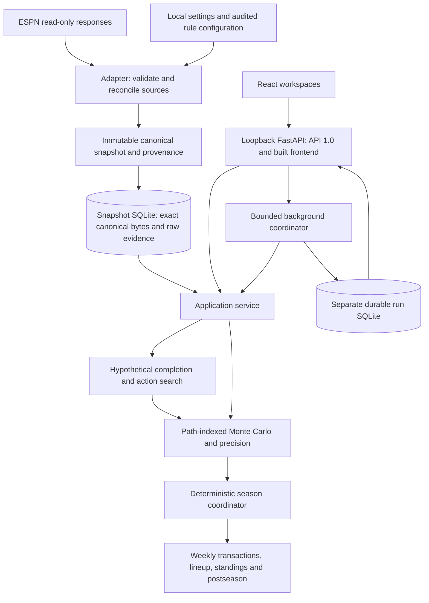

# War Room architecture

War Room turns read-only ESPN observations into immutable league snapshots, then runs reproducible hypothetical season analyses. React presents retained engine results; it does not decide league mechanics or calculate a second probability model. Governing requirements are [MASTER_SPEC sections 2–4 and 8–9](../MASTER_SPEC.md#2-system-architecture-and-execution-lifecycle). [Status](../status.md) describes current capabilities, [backlog](../BACKLOG.md) tracks work, and [roadmap](../ROADMAP.md) preserves historical gates.

## Retrieval and immutable publication

[config.py](../../src/fantasy_football/config.py) loads league/season, paired private credentials and optional rule-file path. Launcher storage settings have different precedence; use [configuration](../getting-started/configuration.md). The [adapter](../../src/fantasy_football/espn_adapter.py) retrieves complete paginated evidence, reconciles identities/context and distinguishes unavailable data from explicit zeros. Audited manual rules can fill permitted source gaps; they cannot override known ESPN facts or authorize unsupported mechanics. Missing evidence stays unresolved.

[Canonical models/validation](../../src/fantasy_football/canonical/model.py) separate stable entities, ownership, player-week projections, source references and rule interpretations. Current document schema is **4**; reads support **2, 3, 4**. A valid document can still lack a consumer-specific capability. [SnapshotStore](../../src/fantasy_football/snapshot_store.py) assigns publication identity, validates deterministic canonical/raw representations and commits atomically in snapshot SQLite schema **1**. Later refreshes append new UUIDs. Stored exact bytes/checksums and source provenance remain authoritative; parsed raw-response representations are not HTTP wire bytes. See [canonical](../CANONICAL_MODEL.md) and [storage](../SNAPSHOT_STORAGE.md).

## One season engine, multiple outcome inputs

[season_simulator.py](../../src/fantasy_football/season_simulator.py) owns week progression and reuses [weekly transactions](../../src/fantasy_football/weekly_transactions.py), [lineup optimization](../../src/fantasy_football/lineup_optimizer.py), [weekly scoring](../../src/fantasy_football/weekly_engine.py) and [postseason](../../src/fantasy_football/postseason.py). Rules come from validated configuration, not fixed league templates. Immutable [evolving state](../../src/fantasy_football/evolving_state.py) is simulation-path state, separate from source snapshots.

[Player outcome models](../../src/fantasy_football/player_outcomes.py) create deterministic score scenarios keyed by seed/path/player/season/week/model. [Monte Carlo](../../src/fantasy_football/monte_carlo.py) repeats the same season coordinator and aggregates configured teams' outcomes. [Precision](../../src/fantasy_football/monte_carlo_precision.py), [bounded workers](../../src/fantasy_football/monte_carlo_parallel.py) and [checkpoint execution](../../src/fantasy_football/monte_carlo_execution.py) preserve fixed-path identities. Adaptive stopping depends on the configured look schedule. Sampling intervals do not measure model error; both [Normal and empirical models](../PLAYER_OUTCOME_MODEL.md) remain provisional.

Ordinary V1 uses a safe whole-week boundary and projected optimal lineups. Opt-in [partial evidence/composition](../../src/fantasy_football/partial_week.py) feeds the same coordinator with fixed actuals and explicitly supplied realizations after cutoff, observed-lineup, lock, membership and carry reconciliation. Deterministic partial input supports more states than the **fully unstarted-only** partial Monte Carlo path. These are engine-only inputs, with no automatic ESPN translator or public partial execution DTO. See the [capability map](../LW2_PARTIAL_WEEK_CONTRACT.md#current-capability-map).

## Hypothetical actions and matched comparisons

[scenario_evaluator.py](../../src/fantasy_football/scenario_evaluator.py) validates explicit exchanges/completion against snapshot ownership, then compares baseline and hypothetical seasons on the same path-indexed player/week outcomes. Ownership does not enter draw keys. [search_orchestration.py](../../src/fantasy_football/search_orchestration.py) coordinates configured trade/acquisition/chain universes, candidate coverage, shared completed-state evaluation and paired impacts. Response pagination is not search coverage; a capped search is not exhaustive. Hypothetical feasibility does not imply ESPN execution, manager acceptance or waiver success. Current-week partial actions remain restricted; actions cannot retroactively alter fixed points or locked assignments.

## Local application and persistence

[app/contracts.py](../../src/fantasy_football/app/contracts.py) defines strict API **1.0** DTOs; [service.py](../../src/fantasy_football/app/service.py) adapts them to accepted engines. [http.py](../../src/fantasy_football/app/http.py) exposes the [route inventory](../APPLICATION_SERVICE.md#versioned-http-surface), Host/Origin checks and built frontend files. [server.py](../../src/fantasy_football/app/server.py) binds loopback only. [React](../../frontend/src/App.tsx) submits explicit requests and displays retained provenance, uncertainty and completeness.

[background.py](../../src/fantasy_football/app/background.py) admits bounded analysis runs and persists requests, progress, outcomes and query data in adjacent `.runs.sqlite3`, separate from immutable snapshots. Cancellation is cooperative; startup marks abandoned runs interrupted, without automatic HTTP resume. Retained queries do not resimulate. [refresh.py](../../src/fantasy_football/app/refresh.py) separately owns transient read-only retrieval jobs and atomic snapshot publication. Engine checkpoint recovery, durable analysis-run recovery and authenticated launcher process recovery are distinct contracts. See [run management](../RUN_MANAGEMENT.md) and [operations](../getting-started/operations.md).

## Extension boundaries

- Keep network retrieval outside analytical execution and publication transactions. Preserve raw/source IDs, temporal context and evidence classifications; synthetic tests never establish live ESPN semantics.
- Preserve schema/version compatibility and original stored bytes; capability checks must not be inferred from a version number alone.
- Keep projections, draw records, lineup eligibility, actual scores and lock/cutoff authority separate. A positive draw is not permission to select a player.
- Reuse season/weekly/postseason resolution and probability aggregation; preserve path keys, fingerprints and matched draws. New evidence belongs in explicit opt-in identity, not a hidden mutable cache.
- Let the engine enforce rules and completeness; the API/UI validate and present them. API version 1.0 does not imply that every engine interface is exposed.
- Preserve private local stores, leases and ownership checks. Public/multi-user hosting remains unsupported; M8.4 has no independent release disposition.

This is source/test reconciliation, not a new model or live validation. [R2.3 inventory](../R23_DOCUMENTATION_RECONCILIATION.md) records drift, evidence, unresolved wording and actual checks.
